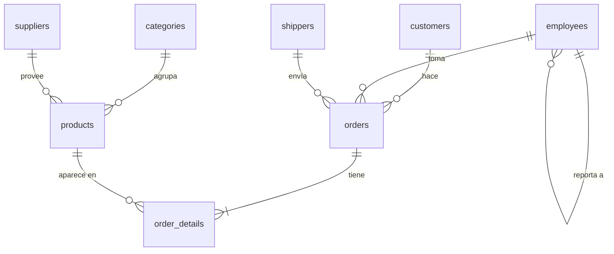

# Semana 7 · Clase 13 — SQL avanzado: vistas, índices, procedimientos almacenados y triggers

> 🎯 **Objetivo:** conocer los objetos que "viven" dentro de la base de datos (vistas, índices, funciones, procedimientos y triggers) usando el **minimercado**. Al final presentamos **Northwind**, la base con la que trabajamos el resto del módulo.
>
> 📝 **Tarea:** [Tarea Clase 13 — SQL avanzado sobre el minimercado](../../tasks/semana_7/clase_13.md)

---

## 🧩 1. Vistas

Una **vista** es una consulta guardada con un nombre. **No guarda datos**: cada vez que se consulta, ejecuta su `SELECT` sobre los datos actuales de las tablas.

Sirven para:

- Esconder `JOIN`s largos detrás de un nombre simple.
- Reutilizar la misma lógica en muchas consultas.
- Mostrar solo algunas columnas (por ejemplo, ocultar emails o teléfonos).

### 🧾 Vista con el detalle de cada venta

```sql
CREATE OR REPLACE VIEW vista_detalle_ventas AS
SELECT
    v.id                             AS venta_id,
    v.fecha,
    c.nombre                         AS cliente,
    mp.nombre                        AS metodo_pago,
    p.nombre                         AS producto,
    pr.nombre                        AS proveedor,
    vp.cantidad,
    vp.precio_unitario,
    vp.cantidad * vp.precio_unitario AS subtotal
FROM ventas v
JOIN clientes        c  ON c.id  = v.cliente_id
JOIN metodos_pago    mp ON mp.id = v.metodo_pago_id
JOIN venta_productos vp ON vp.venta_id = v.id
JOIN productos       p  ON p.id  = vp.producto_id
JOIN proveedores     pr ON pr.id = p.proveedor_id;
```

Se consulta como si fuera una tabla:

```sql
-- Todo el detalle
SELECT * FROM vista_detalle_ventas;

-- Total gastado por cliente
SELECT cliente, SUM(subtotal) AS total_gastado
FROM vista_detalle_ventas
GROUP BY cliente
ORDER BY total_gastado DESC;

-- Productos más vendidos
SELECT producto, SUM(cantidad) AS unidades
FROM vista_detalle_ventas
GROUP BY producto
ORDER BY unidades DESC;
```

### 📦 Vista de productos con poco stock

```sql
CREATE OR REPLACE VIEW vista_stock_bajo AS
SELECT p.id, p.nombre, p.stock, pr.nombre AS proveedor, pr.telefono
FROM productos p
JOIN proveedores pr ON pr.id = p.proveedor_id
WHERE p.stock < 10;

SELECT * FROM vista_stock_bajo ORDER BY stock;
```

> 💡 En pgAdmin las vistas aparecen en **Schemas → public → Views**. Para borrar una: `DROP VIEW vista_stock_bajo;`

### 🧊 Vista materializada

Una **vista materializada** sí guarda el resultado. Es más rápida de consultar, pero no se actualiza sola: hay que refrescarla. Es la primera idea de "tabla preparada para analizar" (la retomamos en OLAP).

```sql
CREATE MATERIALIZED VIEW mv_ventas_por_mes AS
SELECT DATE_TRUNC('month', fecha)::date AS mes,
       COUNT(*)                         AS cantidad_ventas,
       SUM(total)                       AS total_vendido
FROM ventas
GROUP BY 1;

SELECT * FROM mv_ventas_por_mes ORDER BY mes;

-- Cuando cambian los datos de ventas:
REFRESH MATERIALIZED VIEW mv_ventas_por_mes;
```

---

## 🧩 2. Índices

Un **índice** es como el índice de un libro: en vez de leer todas las páginas (filas) para encontrar algo, Postgres va directo a donde está.

- Las `PRIMARY KEY` y los `UNIQUE` crean un índice automáticamente.
- Las `FOREIGN KEY` **no**: si filtramos o hacemos `JOIN` seguido por una FK, conviene indexarla.

```sql
-- ¿Qué índices tiene la base?
SELECT tablename, indexname, indexdef
FROM pg_indexes
WHERE schemaname = 'public'
ORDER BY tablename;
```

### 🔍 Ver el plan de ejecución con `EXPLAIN`

`EXPLAIN` muestra **cómo** va a ejecutar Postgres una consulta. `EXPLAIN ANALYZE` además la ejecuta y muestra el tiempo real.

El minimercado es muy chico (150 ventas) y Postgres prefiere leer la tabla entera. Para ver la diferencia armamos una tabla de prueba con **1 millón de filas**:

```sql
CREATE TABLE prueba_indices AS
SELECT g                                           AS id,
       (random() * 1000)::int                      AS cliente_id,
       NOW() - random() * INTERVAL '365 days'      AS fecha,
       ROUND((random() * 100)::numeric, 2)         AS total
FROM generate_series(1, 1000000) AS g;

-- Sin índice: "Seq Scan" (lee todas las filas)
EXPLAIN ANALYZE
SELECT * FROM prueba_indices WHERE cliente_id = 42;
```

```sql
CREATE INDEX idx_prueba_cliente_id ON prueba_indices (cliente_id);

-- Con índice: "Bitmap Index Scan" / "Index Scan" (va directo)
EXPLAIN ANALYZE
SELECT * FROM prueba_indices WHERE cliente_id = 42;
```

👉 Comparar el **Execution Time** de las dos ejecuciones.

```sql
DROP TABLE prueba_indices;  -- borra también su índice
```

### 🛒 Índices en el minimercado

```sql
CREATE INDEX idx_ventas_cliente_id         ON ventas (cliente_id);
CREATE INDEX idx_venta_productos_producto  ON venta_productos (producto_id);
CREATE INDEX idx_ventas_fecha              ON ventas (fecha);
```

| ✅ Conviene indexar                                       | ❌ No conviene                                                                        |
| --------------------------------------------------------- | ------------------------------------------------------------------------------------- |
| Columnas que se usan mucho en `WHERE`, `JOIN`, `ORDER BY` | Tablas muy chicas                                                                     |
| Foreign keys                                              | Columnas que casi nunca se filtran                                                    |
| Tablas grandes que se leen mucho                          | Tablas con muchísimas escrituras (cada `INSERT`/`UPDATE` también actualiza el índice) |

---

## 🧩 3. Funciones y procedimientos almacenados

Código que se guarda **dentro** de la base y se ejecuta por nombre.

|                   | Función (`FUNCTION`)  | Procedimiento (`PROCEDURE`)               |
| ----------------- | --------------------- | ----------------------------------------- |
| Devuelve un valor | Sí                    | No (hace acciones)                        |
| Cómo se usa       | Dentro de un `SELECT` | Con `CALL`                                |
| Uso típico        | Calcular algo         | Modificar datos (`INSERT`, `UPDATE`, ...) |

> 💡 El código va entre `$$ ... $$`. `LANGUAGE sql` es una sola consulta; `LANGUAGE plpgsql` permite variables, `IF`, mensajes, etc.

### 🧮 Función: total gastado por un cliente

```sql
CREATE OR REPLACE FUNCTION fn_total_gastado(p_cliente_id INT)
RETURNS NUMERIC
LANGUAGE sql
AS $$
    SELECT COALESCE(SUM(vp.cantidad * vp.precio_unitario), 0)
    FROM ventas v
    JOIN venta_productos vp ON vp.venta_id = v.id
    WHERE v.cliente_id = p_cliente_id;
$$;

-- Se usa como cualquier función de SQL
SELECT nombre, fn_total_gastado(id) AS total_gastado
FROM clientes
ORDER BY total_gastado DESC;
```

### ⚙️ Procedimiento: aumentar precios de un proveedor

```sql
CREATE OR REPLACE PROCEDURE sp_aumentar_precios(p_proveedor_id INT, p_porcentaje NUMERIC)
LANGUAGE plpgsql
AS $$
DECLARE
    v_filas INT;
BEGIN
    UPDATE productos
    SET precio = ROUND(precio * (1 + p_porcentaje / 100), 2)
    WHERE proveedor_id = p_proveedor_id;

    GET DIAGNOSTICS v_filas = ROW_COUNT;  -- cuántas filas modificó el UPDATE
    RAISE NOTICE 'Se actualizaron % productos', v_filas;
END;
$$;

-- Lácteos del Valle (id 8) aumenta 10 %
SELECT nombre, precio FROM productos WHERE proveedor_id = 8;
CALL sp_aumentar_precios(8, 10);
SELECT nombre, precio FROM productos WHERE proveedor_id = 8;
```

---

## 🧩 4. Triggers

Un **trigger** ejecuta una función **automáticamente** cuando pasa algo en una tabla (`INSERT`, `UPDATE` o `DELETE`). Se arma en dos partes:

1. Una **función de trigger** (`RETURNS TRIGGER`).
2. El **trigger** que la conecta a la tabla y al evento.

Dentro de la función:

- `NEW` → la fila nueva (en `INSERT` y `UPDATE`).
- `OLD` → la fila anterior (en `UPDATE` y `DELETE`).

### 📉 Descontar stock al vender

```sql
-- 1. Función de trigger
CREATE OR REPLACE FUNCTION fn_descontar_stock()
RETURNS TRIGGER
LANGUAGE plpgsql
AS $$
BEGIN
    UPDATE productos
    SET stock = stock - NEW.cantidad
    WHERE id = NEW.producto_id;

    RETURN NEW;
END;
$$;

-- 2. Trigger: después de cada INSERT en venta_productos
CREATE TRIGGER trg_descontar_stock
AFTER INSERT ON venta_productos
FOR EACH ROW
EXECUTE FUNCTION fn_descontar_stock();
```

Probarlo:

```sql
SELECT id, nombre, stock FROM productos WHERE id = 1;   -- Leche Entera: 100

-- Nueva venta (RETURNING muestra el id que se generó)
INSERT INTO ventas (cliente_id, metodo_pago_id)
VALUES (1, 3)
RETURNING id;

-- Usar el id que devolvió el INSERT anterior (con el dataset original es 151)
INSERT INTO venta_productos (venta_id, producto_id, cantidad, precio_unitario)
VALUES (151, 1, 3, 1.50);

SELECT id, nombre, stock FROM productos WHERE id = 1;   -- ahora: 97
```

### 🚫 ¿Y si no hay stock?

El Jamón Cocido (id 25) tiene stock 0. Al descontar quedaría negativo y el `CHECK (stock >= 0)` de `productos` lo impide:

```sql
INSERT INTO venta_productos (venta_id, producto_id, cantidad, precio_unitario)
VALUES (151, 25, 2, 3.10);
-- ERROR: new row for relation "productos" violates check constraint "productos_stock_check"
```

👉 Falla **todo**: tampoco se guarda la línea en `venta_productos`. El trigger y el `INSERT` son una sola operación.

> 💡 `AFTER` corre después de guardar la fila; `BEFORE` corre antes y puede modificar `NEW` o cancelar el cambio. Para borrar un trigger: `DROP TRIGGER trg_descontar_stock ON venta_productos;`

---

## 🧩 5. Presentación: Northwind

A partir de la próxima clase dejamos el minimercado y pasamos a **Northwind**: la base de ejemplo clásica de una distribuidora de alimentos que vende a clientes de todo el mundo.

Es el mismo tipo de negocio que el minimercado, pero más grande:

| Minimercado       | Northwind       | Contenido                                  |
| ----------------- | --------------- | ------------------------------------------ |
| `clientes`        | `customers`     | Clientes (empresas de 21 países)           |
| `ventas`          | `orders`        | Pedidos (cliente, empleado, fechas, envío) |
| `venta_productos` | `order_details` | Líneas de cada pedido (producto, cantidad) |
| `productos`       | `products`      | Productos (precio, stock)                  |
| `proveedores`     | `suppliers`     | Proveedores                                |
| —                 | `categories`    | Categorías de productos                    |
| —                 | `employees`     | Empleados que toman los pedidos (con jefe) |
| `metodos_pago`    | `shippers`      | Empresas de envío                          |


