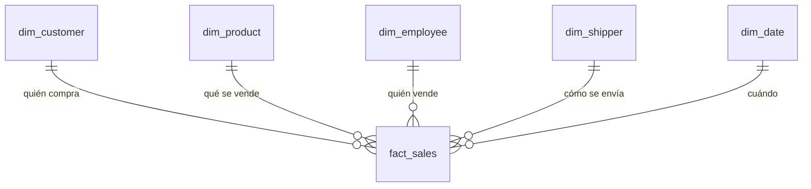

# Semana 8 · Clase 15 — Explorar Northwind y armar el modelo estrella (OLAP)

> 🎯 **Objetivo:** conocer Northwind con consultas (de simples a `JOIN`s múltiples) y, a partir de eso, transformarla en un **esquema estrella** (tabla de hechos + dimensiones) usando `CREATE TABLE ... AS SELECT` (CTAS).
>
> 📝 **Tarea:** [Tarea Clase 15 — Consultas sobre Northwind + esquema estrella](../../tasks/semana_8/clase_15.md)

---

## 🧩 1. Conocer Northwind con consultas

Base restaurada en la [Clase 14](../semana_7/clase_14.md). Tablas principales (ver el diagrama en la [Clase 13](../semana_7/clase_13.md#-5-presentación-northwind)):

| Tabla           | Contenido                                   |
| --------------- | ------------------------------------------- |
| `customers`     | Clientes                                    |
| `orders`        | Pedidos (cliente, empleado, fechas, envío)  |
| `order_details` | Líneas de cada pedido (producto, cantidad)  |
| `products`      | Productos (precio, stock, categoría)        |
| `categories`    | Categorías de productos                     |
| `suppliers`     | Proveedores                                 |
| `employees`     | Empleados (con `reports_to` → su jefe)      |
| `shippers`      | Empresas de envío                           |

### 1️⃣ Listar todos los clientes

```sql
SELECT *
FROM customers;
```

### 2️⃣ Nombre de producto y precio unitario

```sql
SELECT product_name, unit_price
FROM products;
```

### 3️⃣ Productos con precio mayor a 50

```sql
SELECT product_name, unit_price
FROM products
WHERE unit_price > 50;
```

### 4️⃣ Clientes ordenados por país

```sql
SELECT company_name, country
FROM customers
ORDER BY country;
```

### 5️⃣ Cantidad total de pedidos

```sql
SELECT COUNT(*) AS total_pedidos
FROM orders;
```

### 6️⃣ Productos con stock bajo (menos de 10 unidades)

```sql
SELECT product_name, units_in_stock
FROM products
WHERE units_in_stock < 10;
```

### 7️⃣ JOIN simple: productos y su proveedor

```sql
SELECT p.product_name, s.company_name AS proveedor
FROM products p
JOIN suppliers s ON p.supplier_id = s.supplier_id;
```

### 8️⃣ JOIN con filtro: productos caros y su categoría

```sql
SELECT p.product_name, c.category_name, p.unit_price
FROM products p
JOIN categories c ON p.category_id = c.category_id
WHERE p.unit_price > 50;
```

### 9️⃣ JOIN múltiple: pedidos con cliente y empleado

```sql
SELECT o.order_id,
       c.company_name AS cliente,
       e.first_name || ' ' || e.last_name AS empleado
FROM orders o
JOIN customers c ON o.customer_id = c.customer_id
JOIN employees e ON o.employee_id = e.employee_id;
```

### 🔟 JOIN múltiple con filtro: pedidos enviados a Alemania

```sql
SELECT c.company_name AS cliente,
       p.product_name,
       od.quantity,
       o.ship_country
FROM orders o
JOIN customers c      ON o.customer_id = c.customer_id
JOIN order_details od ON o.order_id = od.order_id
JOIN products p       ON od.product_id = p.product_id
WHERE o.ship_country = 'Germany';
```

### 1️⃣1️⃣ SELF JOIN: cada empleado y su jefe

```sql
SELECT e.first_name || ' ' || e.last_name AS empleado,
       j.first_name || ' ' || j.last_name AS jefe
FROM employees e
LEFT JOIN employees j ON e.reports_to = j.employee_id
ORDER BY jefe, empleado;
```

👉 Con `LEFT JOIN` aparece también el empleado que no reporta a nadie (jefe = `NULL`).

### 1️⃣2️⃣ La pregunta de negocio: ¿cuánto vendimos por categoría?

```sql
SELECT c.category_name,
       ROUND(SUM(od.quantity * od.unit_price * (1 - od.discount))::numeric, 2) AS total_ventas
FROM order_details od
JOIN products p   ON od.product_id = p.product_id
JOIN categories c ON p.category_id = c.category_id
GROUP BY c.category_name
ORDER BY total_ventas DESC;
```

👉 Cada pregunta de análisis nos obliga a recorrer 3, 4 o 5 tablas y repetir la fórmula del monto. Eso es lo que resuelve el modelo estrella.

---

## 🧩 2. Análisis: del modelo transaccional al modelo estrella

Antes de escribir SQL, decidimos el modelo respondiendo tres preguntas.

### ❓ ¿Qué preguntas queremos responder?

¿Cuánto vendemos por **producto**, por **categoría**, por **país** del cliente, por **empleado**, por **mes** y por **empresa de envío**?

### 📏 ¿Qué medimos? → la tabla de **hechos**

- El evento de negocio es la **venta**.
- **Granularidad** (qué representa cada fila): **una línea de pedido** (un producto dentro de un pedido). Es el nivel más detallado que tenemos; desde ahí se puede sumar a cualquier nivel.
- **Métricas** (números que se suman): cantidad y monto.

### 🧭 ¿Por qué queremos "cortar" los números? → las **dimensiones**

Cada "por..." de las preguntas es una dimensión: **quién** compra, **qué** se vende, **quién** vende, **cómo** se envía, **cuándo** pasa.

### Tabla de hechos: `fact_sales`

📦 Origen: `orders` + `order_details`.

| Campo          | Origen                                           |
| -------------- | ------------------------------------------------ |
| `order_id`     | `order_details.order_id`                         |
| `order_date`   | `orders.order_date`                              |
| `customer_id`  | `orders.customer_id`                             |
| `employee_id`  | `orders.employee_id`                             |
| `shipper_id`   | `orders.ship_via`                                |
| `product_id`   | `order_details.product_id`                       |
| `quantity`     | `order_details.quantity`                         |
| `unit_price`   | `order_details.unit_price`                       |
| `discount`     | `order_details.discount`                         |
| `total_amount` | `quantity * unit_price * (1 - discount)`         |

### Dimensiones

| Dimensión      | Fuente en Northwind                    | Campos principales                                          | Responde        |
| -------------- | -------------------------------------- | ----------------------------------------------------------- | --------------- |
| `dim_customer` | `customers`                            | customer_id, company_name, contact_name, country, city, region | Quién compra    |
| `dim_product`  | `products` + `categories` + `suppliers` | product_id, product_name, category_name, supplier_name      | Qué se vende    |
| `dim_employee` | `employees`                            | employee_id, first_name, last_name, title, city, country    | Quién vende     |
| `dim_shipper`  | `shippers`                             | shipper_id, shipper_name                                     | Cómo se envía   |
| `dim_date`     | generada desde `orders.order_date`     | date_key, year, quarter, month, day, weekday                 | Cuándo ocurre   |



👉 `dim_product` **desnormaliza**: junta en una sola tabla datos que en Northwind están en `products`, `categories` y `suppliers`.

---

## 🧩 3. Preparación: un schema analítico

Separamos el modelo analítico del transaccional (`public`) en su propio schema:

```sql
CREATE SCHEMA IF NOT EXISTS northwind_olap;
```

---

## 🧩 4. Tabla de hechos: `fact_sales`

`orders` y `order_details` tienen relación 1:N (un pedido tiene muchas líneas). Partimos de las líneas y traemos los datos del pedido:

```sql
CREATE TABLE northwind_olap.fact_sales AS
SELECT
    od.order_id,
    o.order_date,
    o.customer_id,
    o.employee_id,
    o.ship_via AS shipper_id,
    od.product_id,
    od.quantity,
    od.unit_price,
    od.discount,
    (od.quantity * od.unit_price * (1 - od.discount))::numeric(10,2) AS total_amount
FROM public.order_details od
JOIN public.orders o ON od.order_id = o.order_id;

SELECT * FROM northwind_olap.fact_sales;
```

> 💡 Un CTAS es "guardar como tabla" el resultado de un `SELECT`: lo mismo que hicimos en la exploración, pero persistido.

---

## 🧩 5. Dimensiones

### 🧭 `dim_customer`

```sql
CREATE TABLE northwind_olap.dim_customer AS
SELECT
    customer_id,
    company_name,
    contact_name,
    country,
    city,
    region
FROM public.customers;
```

### 📦 `dim_product`

Combinamos `products` con `categories` y `suppliers` (desnormalizamos):

```sql
CREATE TABLE northwind_olap.dim_product AS
SELECT
    p.product_id,
    p.product_name,
    c.category_name,
    s.company_name AS supplier_name
FROM public.products p
LEFT JOIN public.categories c ON p.category_id = c.category_id
LEFT JOIN public.suppliers s  ON p.supplier_id = s.supplier_id;
```

### 👩‍💼 `dim_employee`

```sql
CREATE TABLE northwind_olap.dim_employee AS
SELECT
    employee_id,
    first_name,
    last_name,
    title,
    city,
    country
FROM public.employees;
```

### 🚚 `dim_shipper`

```sql
CREATE TABLE northwind_olap.dim_shipper AS
SELECT
    shipper_id,
    company_name AS shipper_name
FROM public.shippers;
```

### 📅 `dim_date`

Generamos una tabla de fechas a partir de las fechas reales de las órdenes:

```sql
CREATE TABLE northwind_olap.dim_date AS
SELECT DISTINCT
    order_date::date AS date_key,
    EXTRACT(YEAR FROM order_date)::int    AS year,
    EXTRACT(QUARTER FROM order_date)::int AS quarter,
    EXTRACT(MONTH FROM order_date)::int   AS month,
    TO_CHAR(order_date, 'Month')          AS month_name,
    EXTRACT(DAY FROM order_date)::int     AS day,
    EXTRACT(DOW FROM order_date)::int     AS weekday,
    TO_CHAR(order_date, 'Day')            AS weekday_name
FROM public.orders
WHERE order_date IS NOT NULL;
```

### ✅ Resultado

El schema `northwind_olap` queda con: `fact_sales`, `dim_customer`, `dim_product`, `dim_employee`, `dim_shipper` y `dim_date`, listo para consultas analíticas y para conectar una herramienta de BI (lo hacemos con Metabase en la [Clase 16](clase_16.md)).

---

## 🧩 6. Consultas analíticas

### 🔁 La misma pregunta, antes y después

¿Cuánto vendimos por categoría? En el modelo estrella: **un solo `JOIN`** y el monto ya calculado.

```sql
SELECT
    p.category_name,
    SUM(f.total_amount) AS total_sales
FROM northwind_olap.fact_sales f
JOIN northwind_olap.dim_product p ON f.product_id = p.product_id
GROUP BY p.category_name
ORDER BY total_sales DESC;
```

> 💡 Puede diferir en unos centavos de la consulta 1️⃣2️⃣ (267868.16 vs 267868.18 en Beverages): en `fact_sales` el monto se redondea **por línea**, y en la 1️⃣2️⃣ se redondea al final.

### 📊 Ventas totales por producto

```sql
SELECT
    p.product_name,
    SUM(f.total_amount) AS total_sales
FROM northwind_olap.fact_sales f
JOIN northwind_olap.dim_product p ON f.product_id = p.product_id
GROUP BY p.product_name
ORDER BY total_sales DESC;
```

### 🌎 Ventas por país del cliente

```sql
SELECT
    c.country,
    SUM(f.total_amount) AS total_sales
FROM northwind_olap.fact_sales f
JOIN northwind_olap.dim_customer c ON f.customer_id = c.customer_id
GROUP BY c.country
ORDER BY total_sales DESC;
```

### 👩‍💼 Ventas por empleado

```sql
SELECT
    e.first_name || ' ' || e.last_name AS employee_name,
    SUM(f.total_amount) AS total_sales,
    COUNT(DISTINCT f.order_id) AS orders_handled
FROM northwind_olap.fact_sales f
JOIN northwind_olap.dim_employee e ON f.employee_id = e.employee_id
GROUP BY employee_name
ORDER BY total_sales DESC;
```

### 🗓️ Ventas mensuales

```sql
SELECT
    d.year,
    d.month,
    d.month_name,
    SUM(f.total_amount) AS total_sales
FROM northwind_olap.fact_sales f
JOIN northwind_olap.dim_date d ON f.order_date = d.date_key
GROUP BY d.year, d.month, d.month_name
ORDER BY d.year, d.month;
```

### 🏆 Top 10 clientes

```sql
SELECT
    c.company_name AS customer,
    SUM(f.total_amount) AS total_sales
FROM northwind_olap.fact_sales f
JOIN northwind_olap.dim_customer c ON f.customer_id = c.customer_id
GROUP BY c.company_name
ORDER BY total_sales DESC
LIMIT 10;
```

### 🚚 Ventas por empresa de envío

```sql
SELECT
    s.shipper_name,
    SUM(f.total_amount) AS total_sales,
    COUNT(DISTINCT f.order_id) AS total_orders
FROM northwind_olap.fact_sales f
JOIN northwind_olap.dim_shipper s ON f.shipper_id = s.shipper_id
GROUP BY s.shipper_name
ORDER BY total_sales DESC;
```
